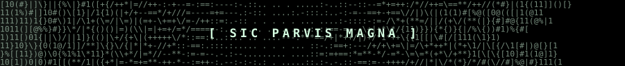
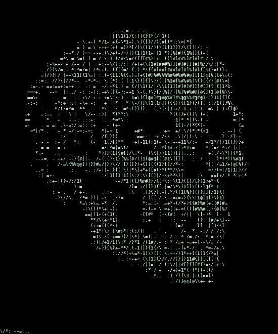
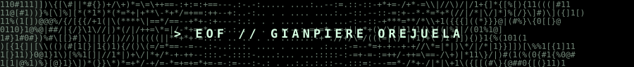

  

  

 

  

 

  <samp>
    +--[&nbsp;github&nbsp;//&nbsp;PROFILE&nbsp;]-----------------------------------------+ 
    |&nbsp;&nbsp;ID&nbsp;..........&nbsp;Gianpiere&nbsp;Orejuela&nbsp;Lluncor&nbsp;&nbsp;&nbsp;&nbsp;&nbsp;&nbsp;&nbsp;&nbsp;&nbsp;&nbsp;&nbsp;&nbsp;&nbsp;&nbsp;&nbsp;&nbsp;&nbsp;&nbsp;&nbsp;&nbsp;&nbsp;&nbsp;| 
    |&nbsp;&nbsp;STATUS&nbsp;......&nbsp;ONLINE&nbsp;24/7&nbsp;:)&nbsp;&nbsp;&nbsp;&nbsp;&nbsp;&nbsp;&nbsp;&nbsp;&nbsp;&nbsp;&nbsp;&nbsp;&nbsp;&nbsp;&nbsp;&nbsp;&nbsp;&nbsp;&nbsp;&nbsp;&nbsp;&nbsp;&nbsp;&nbsp;&nbsp;&nbsp;&nbsp;&nbsp;&nbsp;&nbsp;&nbsp;&nbsp;&nbsp;&nbsp;| 
    |&nbsp;&nbsp;FOCUS&nbsp;.......&nbsp;IA&nbsp;agents,&nbsp;RAG,&nbsp;n8n,&nbsp;bots,&nbsp;RPAs&nbsp;&nbsp;&nbsp;&nbsp;&nbsp;&nbsp;&nbsp;&nbsp;&nbsp;&nbsp;&nbsp;&nbsp;&nbsp;&nbsp;&nbsp;&nbsp;&nbsp;| 
    +----------------------------------------------------------------+
  </samp>

 

<table>
  <tr>
    <td align="center"></td>
    <td align="center"></td>
    <td align="center"></td>
  </tr>
</table>

<table>
  <tr>
    <td align="center"></td>
    <td align="center"></td>
  </tr>
</table>

 

<h3 align="center"><code>&gt; stack --list</code></h3>

  
  
  
  
  
  
  
  
  
  
  
  
  
  
  

 

  
  
  
  

 

  

